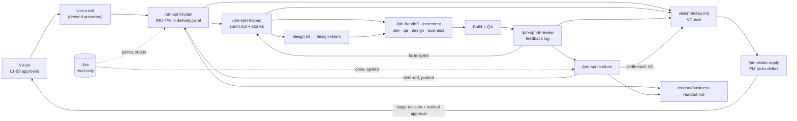

# PM-OS Sprint Mode Plan: vision, sprints and the loops between them

**Status:** 🔵 Design only, nothing built. Recorded 2026-10-28 against v1.5.6.
**Author:** Karan (with Claude Code)
**Revises:** `pm-os-modes-delivery-and-handoff-plan.md` §8.7 "The sprint path" (branch `docs/delivery-plan-part-b`, 21 Oct, unmerged). It keeps §8.7's increment record, checks, per-increment packages, per-epic views and migration, and changes five things (§9).
**Evidence:** how PRISM ran sprints 1-3 (`prism-ai/pmos-sprint-mode/01-process-as-practised.md`) and APEX's feedback on PRISM (backlog #70-#79).
**Backlog:** #28 (increments), #66 (large artifacts), #23 (decision record, partly), #22 (kept), #76 (concise stories, for sprint stories).
**Build plan:** [`pm-os-sprint-mode-build-plan.md`](pm-os-sprint-mode-build-plan.md) covers how PM-OS is changed, tested and verified to deliver this design, and keeps the PRISM pilot separate from the engine work. The PRISM evidence lives in that product's project folder (`~/pm-projects/prism-ai/pmos-sprint-mode/`), not in this repo.

---

## 1. The problem

PM-OS plans a product once: stages 01-09, approved, handed off once. Teams don't build that way. They build sprint by sprint: the PM picks a slice, writes sprint requirements and stories, design returns frames, dev and QA get the same stories, and what the build and the business teach us changes the next sprint. On PRISM that loop ran entirely outside PM-OS for three sprints, and the vision drifted away from it. The R1 PRD still describes a product that sprint 1's reset, sprint 2's dropped checks and sprint 3's new structures no longer match, and no sprint FR or story cites a vision id.

This plan adds that loop to PM-OS without changing how stages are gated.

## 2. Principles

1. **Two layers, sorted by rate of change.** The **vision** (stages 01-09) stays gated, hashed and approved, and changes slowly. The **delivery** layer (sprints) is ungated and changes weekly. No new stage, no change to approval, hashing or the stale cascade. Grow the spine, not the state machine.
2. **The vision changes only through vision deltas the PM chooses to apply.** A sprint may need scope the vision doesn't have. It records that as a vision delta and carries on. The PM decides when, and whether, each delta goes into the vision docs.
3. **Narrative is hand-written; ids never drift.** The PM writes the sprint's why, flow changes and expected result. Every sprint requirement and story still traces to a vision id or a vision delta. A sprint-local id with neither is an error.
4. **PM-OS owns what and why; Jira owns when and how much.** No points, dates or capacity are stored in PM-OS (#22 kept). PM-OS **reads** them from Jira. It writes to Jira only when the PM explicitly asks in that turn.
5. **Dev and QA get the same stories.** QA's extra is a readout of the technical, functional and flow details, not a separate test plan.
6. **The business sees one living readout,** updated at sprint plan and sprint close.
7. **Generic.** Nothing in PM-OS knows about a product's domain, its review system or its Figma naming.

## 3. The loop



Three loops, each with an owner:

| Loop | From → to | Mechanism |
|---|---|---|
| Inside the sprint | Review, QA, dev questions → sprint spec | `/pm-sprint-review` logs it; a spec change bumps the sprint version and writes a change note (#73) |
| Sprint → next sprint | Close-out → next plan | `deferred` and `parked` in `delivery.yaml`; `close.md`; Jira read of what's done |
| Sprint → vision | Any sprint step → vision docs | `VD-###` in `vision-deltas.md`, applied by `/pm-vision-apply` through normal stage approval |

## 4. Files

All new files are ungated, like `readiness.yaml`: editing them never needs approval, never hashes into `.meta.yaml`, and never makes a stage stale.

| File | Owner | What it is |
|---|---|---|
| `vision.md` | Derived | Summary of the approved vision (§4.1). Rebuilt on every approval of 01-09 and on demand. Never edited by hand |
| `delivery.yaml` | Agent, for the PM | Increment record (§4.2) |
| `vision-deltas.md` | Agent, for the PM | Every proposed change to the vision, with status (§4.3) |
| `sprints/INC-###/` | Agent, for the PM | Sprint workspace: `sprint.md`, `stories/`, `design-kit/`, `design-return/`, `review.md`, `close.md`, `jira-snapshot.yaml` (§4.4) |
| `readout/business-readout.md` | Agent, for the PM | Living business readout (§4.5), with an HTML render |
| `handoff/INC-###/{dev,design,qa,business}/` | Generated | Per-sprint packages (§8.7.5, revised in §6) |
| `by-epic/` | Derived | Per-epic views of 03, 06 and 08 (§8.7.6, unchanged) |

`lib/project_git.py` `OWNED_FILES` gains `delivery.yaml`, `vision-deltas.md`, `vision.md`; `OWNED_DIRS` gains `sprints/`, `by-epic/`, `readout/`.

### 4.1 `vision.md`: the summary sprints plan against

The approved PRD can be 450 KB. Nobody plans a sprint against that. `vision.md` is a few pages, derived from approved artifacts only, with `derived: true` and the source stage versions in frontmatter:

- the problem, users and goals (01, 02);
- the scope boundary and non-goals (02);
- every epic: id, title, one line, priority, horizon (03, 09);
- each epic's stories and requirements as id + title only;
- release horizons and decision gates (09);
- **delivery status per epic**, from `delivery.yaml`: delivered in, planned for, deferred, parked, or not yet assigned;
- **open vision deltas**: count by status, with links.

It is rebuilt by `post-approve.py` next to `.traceability.yaml`, and by `pm_vision.py summary` when `delivery.yaml` or `vision-deltas.md` changes. Being derived, it is never stale and never approved.

### 4.2 `delivery.yaml`

§8.7.3's shape, with these changes:

```yaml
schema_version: 1
jira: {project: PRISM, board: 42}       # optional; read-only source for points and status
increments:
  - id: INC-004
    name: Sprint 4 - claims library
    status: active                     # planned | active | in_review | closed
    builds_on: INC-003
    workspace: sprints/INC-004/
    jira_sprint: "PRISM Sprint 4"      # optional; how to find it in Jira
    goal: >-
      The strategist can build structures from approved claims, not only page sentences.
    members:
      epics: [EPIC-004]
      stories: [US-021]
      requirements: [FR-031]
      sprint_items: [S4-FR-01, S4-FR-02]   # sprint-local; each must name a VD in sprint.md
    deferred:
      - {id: S4-FR-03, to: INC-005, reason: claims CSV format not agreed, decision: OD-46}
      - {id: FR-034, to: parked, reason: no comparison data source, decision: OD-47}
    aliases: {S2-FR-12.4: FR-112}      # sprint id → vision id, written when its VD is applied
    cut_from: {"03": 7, "06": 4, "08": 3}
```

- **`sprint_items`** are new, and allowed only with a vision delta (decision D1, 28 Oct). This reverses §8.7 open decision 8.
- **`aliases`** were PRISM-migration-only in §8.7.10. They are now the normal record of a sprint id that became a vision id.
- **Statuses** add `in_review` (built, under Product review and QA) and drop `released`, since a sprint can have several releases (#73).
- **External increments** for history that wasn't run in PM-OS: `external: sprint-2/`, `status: closed`, no members required.

### 4.3 `vision-deltas.md`

A Markdown doc because people read it, including the business. Each delta is a block with labeled fields, so checks can read it soundly (contract v7 pattern):

```markdown
### VD-007 · Page health checks on the run's page

- **Status:** proposed            <!-- proposed | pending | applied | rejected -->
- **Kind:** add                   <!-- add | change | drop | defer -->
- **Raised in:** INC-002 · sprint spec v0.3 · 14 Oct 2026
- **Affects:** 03 (new epic), 06 (test cases), 08 (tasks), 09 (V1 horizon)
- **Sprint items:** S2-FR-12, S2-FR-13
- **Decision:** OD-31
- **Why:** The checks give the product its own evidence about a page, independent of the recommendation file.
- **Proposed change:** Add an epic "Page health checks" with one requirement per check family...
- **Applied in:** —               <!-- e.g. 03 v8, 06 v5, 09 v3 · 2 Nov 2026 -->
```

- **proposed:** raised, not yet looked at by the PM.
- **pending:** PM has seen it and chose to keep it out of the vision for now. The sprint can still build it.
- **applied:** in the vision; `Applied in` names the stage versions; `aliases` in `delivery.yaml` maps its sprint ids.
- **rejected:** the PM decided the vision shouldn't change. If the sprint item was already built, the delta says what happens to it.

`drop` and `defer` deltas matter as much as `add`: when a sprint drops scope the vision still promises (PRISM's AI crawler checks), the delta is how the vision's "Not planned" section finds out.

### 4.4 The sprint workspace: `sprints/INC-###/`

| File | Written by | Contents |
|---|---|---|
| `sprint.md` | `/pm-sprint-spec` | The sprint PRD (§5.2), versioned v0.1, v0.2…, with a change log |
| `stories/S<n>-US-<nn>.md` | `/pm-sprint-spec` | Concise stories: statement, happy path, Given/When/Then ACs mapped to requirements, edge cases, design (screen, states, fixed copy, frames). Frontmatter: `implements: [US-021, FR-031]` and/or `delta: VD-007`, `jira:` key once known |
| `design-kit/`, `design-return/` | `/pm-sprint-spec --design-kit`, design ingest | Frames to design, and what came back |
| `review.md` | `/pm-sprint-review` | Append-only feedback log (§5.3) |
| `close.md` | `/pm-sprint-close` | Close-out (§5.4) |
| `jira-snapshot.yaml` | Plan and close | What was read from Jira, when, and from which query |

Sprint ids use the sprint number (`S4-US-01`, `S4-FR-01`), which is what PRISM's teams already read. Story points don't live here; they come from the Jira snapshot.

### 4.5 `readout/business-readout.md`

One living document for the business, newest sprint first:

- **Where we are:** one paragraph and a vision coverage line ("6 of 12 epics have something built").
- **Per sprint:** what was built, what's in progress, what's next, what we need from the business, decisions the business owns.
- **What changed in the plan:** applied, pending and rejected vision deltas since the last readout, in plain words.

Updated by `/pm-sprint-plan` (next sprint, asks) and `/pm-sprint-close` (built, spilled, deltas). It's also what the `business` package (§6) ships.

## 5. Skills

New skills follow the existing conventions: `SKILL.md` with `reads`/`writes`/`model_tier`, an `agents/openai.yaml` twin, contract tests. Python scaffolds and validates; the agent writes the content.

| Skill | When | Reads | Writes |
|---|---|---|---|
| `/pm-sprint-plan` | Start or re-plan a sprint | `vision.md`, `delivery.yaml`, last `close.md`, `readiness.yaml`, `vision-deltas.md`, Jira (read) | `delivery.yaml` entry, `sprint.md` skeleton, VDs for new scope, `jira-snapshot.yaml`, business readout "Next" |
| `/pm-sprint-spec` | Write or revise the sprint PRD and stories | `sprint.md`, `by-epic/` views of members, VDs | `sprint.md`, `stories/`, optional `design-kit/`, VDs |
| `/pm-sprint-review` | Feedback from Product review, QA, dev or business | Feedback text the PM pastes or points to | `review.md`, and per item one of: spec change, deferral, VD, `OD-##` |
| `/pm-sprint-close` | End of sprint | `delivery.yaml`, `review.md`, Jira (read) | `close.md`, `delivery.yaml` status and deferrals, VD settlement, business readout |
| `/pm-vision-apply` | Whenever the PM chooses | `vision-deltas.md`, affected stages | Stage revisions through the normal flow, VD status, `aliases` |

Changed: `/pm-handoff` (`--increment`, §6), `/pm-check` (§7), `/pm-status` (active sprint, unsettled deltas), `post-approve.py` (rebuild `vision.md` and `by-epic/`).

### 5.1 `/pm-sprint-plan`

1. Build the candidate list: deferred and parked items, spill-over from Jira, unassigned vision ids by priority and horizon, pending VDs, and the PM's own ideas.
2. Show it as a ranked shortlist with what each needs from the business. The PM picks. The skill never picks.
3. Write the increment: goal, members, `builds_on`, done when, risks.
4. Every picked item the vision lacks becomes a `sprint_items` entry plus a `proposed` VD.
5. Write the `sprint.md` skeleton and update the business readout's "Next".

### 5.2 `/pm-sprint-spec`: the hybrid sprint PRD

`sprint.md` has two kinds of section:

| Hand-written by the PM (through the skill) | Pulled, not rewritten |
|---|---|
| What / who / why now / scope · goals and non-goals · what changes in the flow · research · done when · expected result on the test input · what we need from the business · risks · defaults and open items | Requirements for vision members, cut verbatim by id from approved 03 (§8.7.6 `carve`) · sprint requirements `S<n>-FR-<nn>`, each citing its VD · "Referenced, not in this sprint" appendix |

Revisions after a handoff bump the version, add a change-log line, and the next release's `CHANGES.md` lists the affected stories. That replaces the r4-to-r9 re-zips.

Stories are concise (#76): the experience, not the full spec. The requirement detail stays in `sprint.md`.

### 5.3 `/pm-sprint-review`

Each feedback item is logged with its source (Product review, QA, dev, business), then disposed of in exactly one way:

| Disposition | What happens |
|---|---|
| Fix in this sprint | Spec or story change, version bump, change note |
| Defer | `deferred: {to: INC-###}` with reason |
| Park | `deferred: {to: parked}` with reason and `OD-##` |
| Drop | Removed from members; a `drop` VD if the vision promises it |
| New scope | `sprint_items` or next sprint, plus a VD |
| Needs a decision | `OD-##` in `readiness.yaml` |
| No action | Logged with the reason |

### 5.4 `/pm-sprint-close`

1. Read the sprint's issues from Jira: done, not done, points.
2. Write `close.md`: built, spilled over (auto-deferred to the next increment), parked, dropped, Jira totals.
3. **Settle every VD raised in this sprint:** apply now (hands off to `/pm-vision-apply`), keep pending, or reject. A sprint can't close with a `proposed` VD.
4. Set `status: closed` and update the business readout.

### 5.5 `/pm-vision-apply`

1. List `proposed` and `pending` VDs, grouped by the stages they affect. The PM picks any subset.
2. Plan the revision per stage, in pipeline order (03 first). One stage revision covers all picked deltas for that stage, so one approval and one cascade, not one per delta.
3. Revise each stage **append-only for adds** (new ids, never renumbered; #52 id diff on approval), in place for changes, and into "Not planned" or disposition sections for drops. Large stages are revised in parts and finished with `pm_finish_stage.py` (#63).
4. The PM approves each stage the normal way. Stages the deltas don't touch are re-bound with `--reapprove`.
5. Record `Applied in` on each VD and the sprint-id → vision-id `aliases`.

This is the only path by which delivery changes the vision.

## 6. Packages per sprint: `/pm-handoff --package --increment INC-###`

§8.7.5's layout and release machinery (release check, `manifest.json`, `CHANGES.md`, `.releases/`), with this content:

| Audience | Gets |
|---|---|
| **dev** | `sprint.md`, all sprint stories, design return or frames, contracts and config the PM added, readiness items due, "read in this order" README, open tech questions |
| **qa** | **The same stories as dev**, plus `qa-readout.md`: the flows step by step, functional rules per story, technical details (data, states, contracts, configs, environments), test inputs from `readiness.yaml`, and the regression list from `CHANGES.md` (earlier sprints' stories whose text changed). Test cases from 06 are included only if 06 covers the members |
| **design** | `sprint.md` screen sections, stories' design sections, design kit |
| **business** | `readout/business-readout.md` and its HTML |

**Jira:** `/pm-handoff jira --increment` stays as designed (dry-run, then create only after the PM confirms). In addition, the skill text says plainly: never write to Jira unless the PM asks in that turn. Reads go through the Atlassian connector from the skill and land in `jira-snapshot.yaml`. No script talks to Jira.

## 7. Checks

All read-only, in a Delivery section of `/pm-check`, and added to the release check for increment packages. §8.7.4's `INC_*` codes stay, with `INC_MEMBER_UNDEFINED` now accepting a sprint item that names an existing VD. New:

| Code | Severity | Fires when |
|---|---|---|
| `VD_MISSING` | error | A `sprint_items` id or a story's `delta:` names no VD, or a VD that doesn't exist |
| `SPRINT_STORY_UNTRACED` | error | A sprint story has neither `implements:` nor `delta:` |
| `VD_UNSETTLED` | warning; error at close | A VD raised in this increment is still `proposed` |
| `VD_ALIAS_MISSING` | warning | An `applied` VD's sprint items have no `aliases` entry |
| `VD_PENDING_OLD` | info | A VD has been `pending` for more than two closed increments |
| `SPRINT_NO_CHANGELOG` | warning | `sprint.md` is past v0.1 with no change-log line for the latest version |
| `INC_DESIGN_RETURN_MISSING` | warning | A dev release for a sprint with screens has no design return |
| `JIRA_SNAPSHOT_OLD` | info | Close-out uses a Jira snapshot more than a day old |

## 8. Telemetry

New events, added to the spec's event list (the drift test enforces it): `sprint_planned`, `sprint_spec_revised`, `sprint_feedback_logged`, `sprint_closed`, `vision_delta_raised`, `vision_delta_settled` (`{id, status}`), `vision_delta_applied` (`{ids, stages, versions}`). `handoff_released` gains an `increment` payload field (§8.7.11). Editing the ungated files logs nothing on its own; the events come from the skills.

## 9. What this changes in §8.7

| §8.7 | This plan | Decided |
|---|---|---|
| Scope must enter 03 before a sprint can use it (decision 8) | Sprint items allowed with a vision delta; the PM applies deltas when they choose | Karan, 28 Oct (D1) |
| Sprint PRD generated only, never hand-written | Hybrid: hand-written narrative, requirements cut by id or cited by VD | Karan, 28 Oct (D2) |
| Product stories, cut from 03 | Concise sprint stories tracing to vision ids or VDs; dev and QA get the same ones | Karan, 28 Oct (D2) |
| No points; nothing about Jira reads | No points stored (#22 kept); points and status read from Jira | Karan, 28 Oct (D3) |
| No new skill | Five skills (§5) | Karan, 28 Oct |
| QA folder from 06's test cases | QA gets dev's stories plus a QA readout | Karan, 28 Oct |
| No vision summary | `vision.md` derived summary; living business readout | Karan, 28 Oct |
| `aliases` only for PRISM migration | `aliases` are how every applied delta maps its ids | This plan |

Unchanged from §8.7: `delivery.yaml` as an ungated record, membership by story and requirement with tasks derived, per-increment package folders, per-epic views, `cut_from`, the `INC_*` checks, Jira ancestor closure.

## 10. PRISM pilot

Decision D4 (28 Oct): sprint 4 is the first sprint run in PM-OS.

1. **Record history.** `INC-001`-`INC-003` as `external` and `closed` (S3 closes when it does), pointing at `sprint-1-r2/`, `sprint-2/`, `sprint-3/`. Nothing in those folders is moved, renamed or re-zipped.
2. **Seed `vision-deltas.md` with the drift that already exists,** all `proposed`. For example: the sprint 1 reset (Modify only; the live page is the only approved content); sprint 2's page health checks and technical items; the dropped AI crawler checks and report output; parked pharma checks; sprint 3's structures, added items, editing and manifest; Q&A module dropped on evidence.
3. **The PM settles them,** and applies the ones they choose with `/pm-vision-apply` before planning sprint 4. In-flight sprint ids get `aliases`.
4. **Run sprint 4** through plan, spec, handoff, review and close, with Jira read-only.
5. **Measure:** time to a sprint pack, release-check errors caught, VDs raised and settled, and whether dev, QA and APEX need anything the pack didn't have.

## 11. Build order

Each chunk ships on its own, with its tests, and is green on the full suite in a clean worktree before the next starts.

| Chunk | Work | Unblocks |
|---|---|---|
| **S1** | Merge §8.7's docs branch and this plan. `lib/delivery.py`, `scripts/pm_delivery.py init|check`, `INC_*` checks, `/pm-check` and `/pm-status` sections | Recording PRISM sprints 1-3 |
| **S2** | `lib/vision_deltas.py` (parse labeled fields, validate), `VD_*` checks, `/pm-vision-apply` | Seeding and applying PRISM's drift |
| **S3** | `vision.md` derived summary and `by-epic/` views, rebuilt on approval | Planning against the vision |
| **S4** | `/pm-sprint-plan`, `/pm-sprint-spec`, sprint workspace templates, `SPRINT_*` checks | Sprint 4 plan and spec |
| **S5** | `/pm-handoff --increment` packages including the QA readout and business package | Sprint 4 handoff |
| **S6** | `/pm-sprint-review`, `/pm-sprint-close`, Jira read via the connector, business readout updates | Sprint 4 review and close |

Tests follow §8.7.11, plus: `test_vision_deltas.py` (fields, statuses, settlement rules), `test_vision_apply_flow.py` (append-only ids, aliases written, one approval per stage), `test_sprint_workspace.py` (untraced stories, change log), `test_vision_summary.py` (derived from approved only, never hashed), and contract tests that every new skill has its twin and says "never write to Jira unless asked".

## 12. Open decisions

1. **Sprint id format.** `S4-US-01` (sprint number) or `INC-004-US-01`? **Recommend** `S<n>-…`, matching what teams read; `delivery.yaml` maps `S<n>` to `INC-00n`.
2. **`vision.md` editable or derived?** **Recommend** derived only. A summary the PM can edit becomes a second vision.
3. **Apply granularity.** One revision per stage for all picked deltas, or one per delta? **Recommend** per stage: fewer approvals and cascades.
4. **Drop and defer deltas.** Should applying them edit 03's requirements (mark dropped) and 09's "Not planned", or only 09? **Recommend** both, so the PRD stops promising what was dropped.
5. **Business readout render.** Markdown plus HTML through `lib/html_render.py`, or Markdown only? **Recommend** both; the business reads HTML.
6. **Design kit.** A `--design-kit` flag on `/pm-sprint-spec`, or its own skill? **Recommend** the flag, and fold design-return checks (#78) into S5.
7. **Docs branch.** Merge `docs/delivery-plan-part-b` as is and mark §8.7 "revised by this plan", or rewrite §8.7 in place? **Recommend** merge as is plus this plan, so the history of the decision stays readable.
